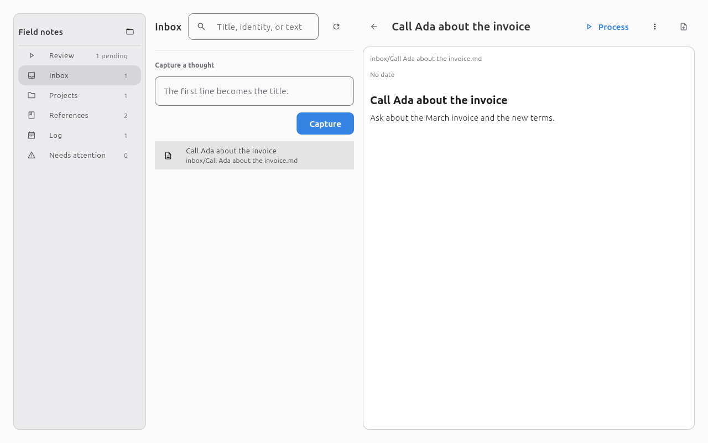

# 🗂️ afanes

Afanes is an offline, local-first Markdown vault: a personal wiki and project engine that keeps every
note as an ordinary `.md` file you own.



## 📦 Run from a source checkout

Afanes runs from a source checkout with Hatch. You need Python 3.13 or newer, Git, and
[Hatch](https://hatch.pypa.io/).

```console
git clone https://github.com/knkillname/afanes.git
cd afanes
hatch env create
hatch run afanes
```

For the browser presentation:

```console
hatch run afanes --web
```

The first desktop run downloads and caches the Flet client once under `~/.flet/client/`. The running
application makes no network request. To build a desktop artifact instead, follow the
[release guide](https://github.com/knkillname/afanes/blob/main/docs/develop/releasing.md); a packaged
build bundles the client.

## 🖥️ Platform support

- **Linux.** Native desktop builds are supported and tested, and Linux is the only `1.0.0` release
  gate. Download the build from the [releases page](https://github.com/knkillname/afanes/releases).
- **macOS and Windows.** Install the released wheel with `pipx` and start the browser presentation:

  ```console
  pipx install "/path/to/afanes-<version>-py3-none-any.whl[web]"
  afanes --web
  ```

  Download the wheel from the releases page first and pass its path. macOS and Windows native
  binaries may also appear on that page; they are experimental, untested at runtime, unsigned, and
  unsupported.

Only Linux carries release evidence. The browser presentation binds loopback only, serves local
assets, and allows one session at a time; see the
[browser mode guide](https://github.com/knkillname/afanes/blob/main/docs/guide/browser-mode.md).

## 🚀 First five minutes

1. **Open or create a vault.** A vault is a folder of Markdown files with an `afanes.yaml` settings
   file at its root; opening a versioned vault is read-only. A folder from an older release can be
   adopted explicitly.
   [Create or open your first vault](https://github.com/knkillname/afanes/blob/main/docs/getting-started/first-vault.md)
2. **Capture a thought.** Type one line in the Inbox. The first line becomes the note's name and
   title.
3. **Clarify it.** Select the capture and choose **Process** to make it a project, a reference, or a
   discarded note.
4. **Work the project.** Add task-list steps and tick them as you go.
5. **Review.** The Review entry shows pending captures, due steps, waiting steps, and projects without
   a next step.

The full walkthrough is in
[Your first five minutes](https://github.com/knkillname/afanes/blob/main/docs/getting-started/capture-clarify-review.md).

## 📚 Documentation

- [Run Afanes](https://github.com/knkillname/afanes/blob/main/docs/getting-started/install.md)
- [Workspace and browser](https://github.com/knkillname/afanes/blob/main/docs/guide/workspace.md)
- [Inbox](https://github.com/knkillname/afanes/blob/main/docs/guide/inbox.md) and
  [projects](https://github.com/knkillname/afanes/blob/main/docs/guide/projects-and-steps.md)
- [Log](https://github.com/knkillname/afanes/blob/main/docs/guide/log.md)
- [Vault format](https://github.com/knkillname/afanes/blob/main/docs/reference/vault-format.md)
- [Command line](https://github.com/knkillname/afanes/blob/main/docs/guide/command-line.md)
- [Browser mode](https://github.com/knkillname/afanes/blob/main/docs/guide/browser-mode.md)
- [Development setup](https://github.com/knkillname/afanes/blob/main/docs/develop/setup.md)
- [Python API](https://github.com/knkillname/afanes/blob/main/docs/api/index.md)

The documentation site is built locally with `hatch run docs:build`. A published site is a later
change; the links above work on GitHub today.

## 🧭 Project status

Afanes is pre-1.0. The unified `1.0.0` gate is defined in
[RELEASE.md](https://github.com/knkillname/afanes/blob/main/RELEASE.md), and the release history is in
[CHANGELOG.md](https://github.com/knkillname/afanes/blob/main/CHANGELOG.md). Linux native builds are
supported and tested; macOS and Windows use the released wheel and `afanes --web`. Every artifact is
unsigned; code signing, notarization, and auto-update are not part of the project.

## 🛠️ Build and contribute

```console
hatch run afanes          # desktop
hatch run afanes --web    # browser
hatch check               # lint, format, types
hatch test --cover        # tests and coverage floor
```

The [development setup](https://github.com/knkillname/afanes/blob/main/docs/develop/setup.md) covers
the environment, tests, and documentation commands.
[AGENTS.md](https://github.com/knkillname/afanes/blob/main/AGENTS.md) is the operating manual for
contributors and agents.

## ⚖️ License

Afanes is distributed under the terms of the
[GNU Affero General Public License v3.0 or later](https://spdx.org/licenses/AGPL-3.0-or-later.html).
