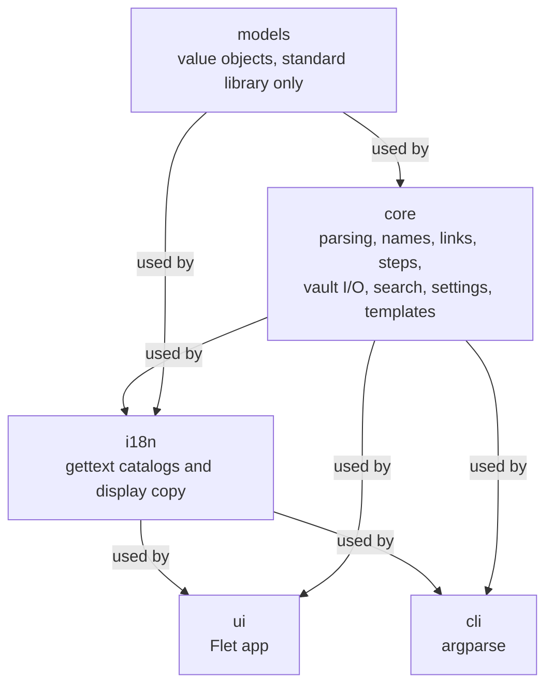

# 🏗️ Architecture

Afanes is a local-first Markdown vault with a layered Python package. The Markdown files are
authoritative; the application scans them into an in-memory snapshot and derives every view from that
snapshot.

:::{admonition} tl;dr
:class: note

The dependency direction is `models <- core <- i18n <- ui` and `core <- i18n <- cli`. `ui` and `cli`
never import each other, `core` never imports Flet or `i18n`, `i18n` never imports Flet or a
presentation package, and `models` imports only the standard library.
:::

## 🧱 Layers



- `models/` holds immutable value objects: note vocabulary, references, and steps.
- `core/` owns parsing, filename policy, linking, step parsing, vault I/O, processing, search, settings,
  and templates.
- `i18n/` owns the English source messages, the reviewed Spanish `.po` catalogs, their generated
  `.mo` build artifacts, the offline compiler, and the catalog loader.
- `ui/` is presentational: the Flet shell, state controllers, views, and shared components.
- `cli/` is a thin adapter over `core` for headless commands.

The import graph is acyclic at submodule level. Import modules for functions and constants, and import
CamelCase types directly. No relative imports, wildcard imports, or `TYPE_CHECKING` blocks.

## 🌍 Localization catalogs

English is the source language. The English modules under `i18n/ui/en.py`, `i18n/cli/en.py`, and
`i18n/messages/en.py` are the schema: every public constant is a gettext source message, and its
constant name is the gettext context. The context keeps identical English values independently
translatable.

The Spanish catalogs live in the standard `localedir` layout:

```text
src/afanes/i18n/locales/
    es/LC_MESSAGES/
        afanes-ui.po / afanes-ui.mo (generated)
        afanes-cli.po / afanes-cli.mo (generated)
        afanes-messages.po / afanes-messages.mo (generated)
```

The runtime loads them with the standard library `gettext.translation(..., fallback=True)`. A missing
Spanish entry renders its English msgid, so a partial catalog never leaves a blank or a mixed-language
sentence. The reviewed `.po` files are the translation source and the only tracked catalogs;
`hatch run i18n-compile` runs `scripts/compile_catalogs.py`, which writes the standard binary `.mo`
format through `afanes.i18n.po.PoCatalog`. The `.mo` files are ignored by Git and generated before
tests and packaging. The compiler is offline and needs no GNU gettext installation. Loading a corrupt
`.mo` falls back to the null catalog.

`MessageCode` and `DomainMessage` carry domain failures across the core boundary without rendered copy.
Every `AfanesError` requires a `DomainMessage`; a raw string message raises `TypeError`, so a core
failure can never bypass the catalogs. The English template lives in `i18n/messages/en.py`, keyed by
the code value, and the Spanish entry lives in the `afanes-messages` catalog. The interface and command
line render them with `copy.render_error` and `MessageCatalog.render`, which substitute values into the
active locale's template. Core never imports `i18n`, and no boundary formats a domain failure with
`str(exc)`.

The copy gate at `tests/i18n/test_copy.py` validates the English source, the Spanish `.po` files, and
the compiled `.mo` files together. The test session compiles the catalogs before the gate runs. It
rejects missing, extra, blank, context-mismatched, or placeholder-mismatched entries, and it fails
when a `.mo` file is stale.

## 🧠 The vault snapshot

There is no SQLite index. Each vault is scanned into an in-memory `VaultSnapshot`; `core/search.py`
derives the browser, project, and review views from it. `Browser`, `ProjectBoard`, and `ReviewPlanner`
are read-only over the snapshot and never read files.

Do not add an indexer, a persistent index, or a background index process without an approved change.

## 🔒 Write rules

All vault writes go through the `Vault` service family. The root is resolved once, every candidate path
must stay inside it, and writes use the same-directory atomic writer. Existing body text, unknown
frontmatter keys, and the newline style are preserved.

One writer owns a vault at a time. Renames, moves, and trash require confirmation and never follow
symlinks outside the vault. Startup and scanning are read-only: opening a vault does not create a file
or folder.

## 🧩 Object ownership

Every new unit is one of:

- a value object: immutable data plus invariants;
- a service object: owns one resource and validates it at construction;
- a controller or view: UI state plus presentation.

Every behavior is a method on its owning class. A stateless transformation is a method on the value object or service that owns the data, not a free function. The name and filename rules live on `NamePolicy`, atomic writes on `AtomicWriter`, user-facing count formatting on the catalog-bound `CopyFormatter`, locale display data on `LocaleFormat`, and the Flet page lifecycle on `AppShell`.

The architecture test is the hard gate: module-level functions, duplicate view helpers, `AppState`
fields, public surface budgets, and the import graph are checked mechanically. The only allowed
module-level function is `entrypoint` in `__main__.py`, the installed script target. Ruff enforces
the `PLR` family with a 50-statement budget and the `C901` complexity limit. Add a temporary
exemption only through an approved change, and remove it when the phase passes.

## 🧭 See also

- [Development setup](setup.md)
- [Testing](testing.md)
- [Documentation guide](documentation.md)
- [AGENTS.md](https://github.com/knkillname/afanes/blob/main/AGENTS.md) for the full rules
