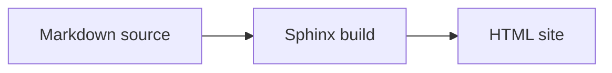

# 📝 Documentation guide

This page is the contract for the Afanes documentation. It explains who owns each layer, how a page is
structured, when to use an admonition, and how to check the result before a change is archived.

:::{admonition} tl;dr
:class: note

`openspec/specs/` is normative, `docs/` explains how to use the behavior, `README.md` is the front
door, and `AGENTS.md` is the operating manual. Every change updates the affected docs page or records
why no user-facing documentation changed.
:::

## 🧭 Ownership

| Layer | Owns | Does not own |
| --- | --- | --- |
| `openspec/specs/` | What must be true, with scenarios backed by tests | Tutorials, screenshots, installation steps |
| `docs/` | The user-facing narrative: how to install, use, and understand Afanes | The normative contract or internal design rules |
| `README.md` | The pitch, install command, five-minute path, and links | The complete manual or build guide |
| `AGENTS.md` | Contributor and agent operating rules | End-user instructions |
| `RELEASE.md` and `CHANGELOG.md` | Release readiness and history | Current usage documentation |

When a behavior changes, update the docs page that explains it. When a change genuinely has no
user-facing effect, say so explicitly in the change's tasks and final report. Silence is not a
documentation decision.

Link to `AGENTS.md` and `RELEASE.md` instead of copying their rules. Docs do not cite numbered
`AGENTS.md` sections; a link to the file stays valid when sections are renumbered.

## 🧱 Page template

Use this shape for a guide or reference page:

```markdown
# 🚀 Page title

One or two sentences that say what the page covers.

:::{admonition} tl;dr
:class: note

The one thing a reader should remember from this page.
:::

## 📥 First section

Prose, examples, and links.

## ✅ See also

- [Related page](path.md)
```

The level-1 heading is the page title and must start with an emoji. The `tl;dr` is recommended for
long guide and reference pages and required by the docs style test on `docs/guide/` and
`docs/reference/` pages.

## 💬 Admonitions

Use the built-in MyST admonitions. Do not add custom CSS or a new admonition type.

| Label | Syntax | Use for |
| --- | --- | --- |
| `tl;dr` | `{admonition} tl;dr` with `:class: note` | A short summary at the top of a long page |
| Tip | `{tip}` | A shortcut, keyboard action, or easier path |
| Warning | `{warning}` | A destructive or irreversible action, a conflict, or data loss |
| Remember | `{important} Remember` | An invariant that applies beyond the current page |

Keep them restrained: one `tl;dr` per page, warnings only for real risk, and `Remember` for rules that
readers should carry into other pages.

## 📊 Diagrams

Use a Mermaid diagram when a page explains relationships or a flow that a reader should grasp as a
whole: package layers, call order, state changes. Keep a literal `text` block when the reader needs to
copy the content verbatim: directory trees, file contents, command output. A diagram replaces
spelling; it must not replace text that has to stay exact.

Write a plain `mermaid` fence. `docs/conf.py` maps it to the Sphinx directive, and GitHub renders the
same fence, so the source does not need a second syntax:



Every diagram starts with `accTitle:` (a short name) and `accDescr:` (one sentence that explains the
diagram). Mermaid turns them into the SVG title and description, and the docs style test rejects a
fence without them.

The Mermaid runtime is vendored under `docs/_static/vendor/mermaid/`, and `docs/conf.py` points at
that copy. Do not replace it with a CDN URL: `docs:build` and `docs:serve` must stay fully local. To
upgrade the runtime, follow `docs/_static/vendor/mermaid/README.md`.

`docs:build` does not parse Mermaid syntax. A malformed diagram still builds, and the error appears in
the browser. After editing a diagram, open the page with `hatch run docs:serve` and check it in both
themes.

## 🎨 Emoji palette

Use one meaningful emoji at the start of every heading in `README.md` and `docs/`. Reuse this palette
so the same idea looks the same everywhere.

| Area | Emoji | Area | Emoji |
| --- | --- | --- | --- |
| Home | 🏠 | Vault format | 📄 |
| Getting started | 🚀 | Frontmatter | 🏷️ |
| Install | 📦 | Names and links | 🔗 |
| Workspace | 🗂️ | Templates | 🧰 |
| Inbox | 📥 | Migration | 🧭 |
| Projects | 🎯 | Troubleshooting | ⚠️ |
| References | 📚 | Develop | 🛠️ |
| Editing | ✍️ | Architecture | 🏗️ |
| Processing | 🔄 | Testing | 🧪 |
| Review | ✅ | Releasing | 🚢 |
| Browser mode | 🌐 | API | 🧩 |
| Command line | 💻 | Documentation | 📝 |
| Diagrams | 📊 | | |

Do not use emoji headings in machine-read Markdown: `AGENTS.md`, `CHANGELOG.md`, `RELEASE.md`, and
`openspec/specs/**` keep their current heading formats.

## 🔗 Links and anchors

Use relative paths between docs pages, for example `[Inbox](../guide/inbox.md)`. Use a link to the
file when the target is `AGENTS.md` or `RELEASE.md`.

GitHub turns an emoji-prefixed heading into an anchor with a leading hyphen, so the README does not
carry an internal table of contents. The docs use explicit MyST targets for headings that other pages
link to:

```markdown
(getting-started)=
# 🚀 Getting started
```

Do not rely on generated anchors for cross-page links. The in-page table of contents still works.

## ✅ Documentation review in every change

For every OpenSpec change:

1. Find the docs pages that explain the behavior being changed.
2. Update those pages in the same change, including screenshots when the interface changes.
3. If the change has no user-facing documentation effect, record `Documentation: no user-facing
   change` in the change's tasks and final report.
4. Run `hatch run docs:build` and the docs style test before reporting the change ready.

The rule is repeated in `AGENTS.md` and in the archive guidance in `openspec/config.yaml` so it
survives a change of maintainer.

## 🛠️ Local commands

Run these from the repository root:

```console
hatch run docs:build
hatch run docs:serve
```

`docs:build` writes the site to `docs/_build/html/` and fails on warnings or broken internal
references. `docs:serve` starts a live-reloading preview on `127.0.0.1` using only local assets.

## 🧪 Checks

| Check | Command | What it proves |
| --- | --- | --- |
| Site build | `hatch run docs:build` | Internal references resolve and Sphinx reports no warnings |
| Docs style | `hatch test tests/docs/test_style.py` | Headings start with emoji, long pages carry a `tl;dr`, diagrams carry accessibility metadata, and the Mermaid runtime is local |
| Examples | `hatch test tests/core/test_integration.py::TestDocumentedExamples` | Documented examples still parse |
| Repository gates | `hatch check` and `hatch test --cover` | The rest of the project still passes |

External link checking needs network access and is not part of the local gate.
